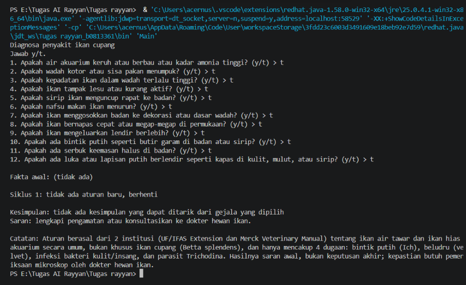
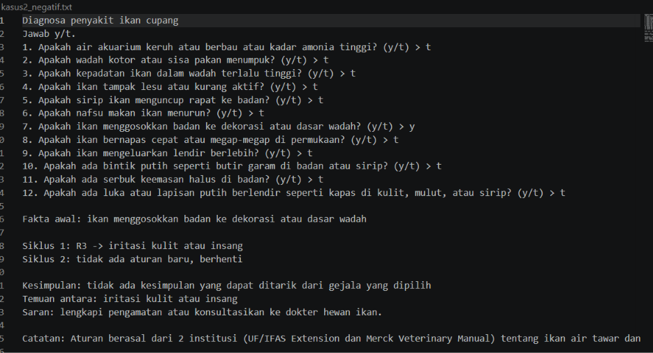
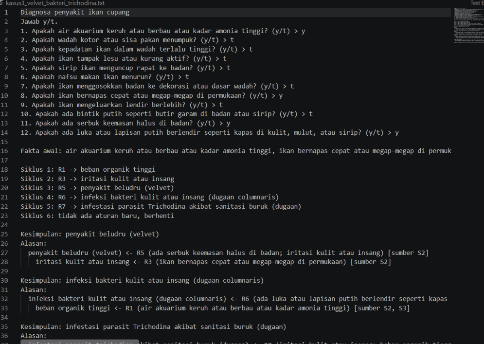

# Sistem Pakar Diagnosa Penyakit Ikan Cupang (Forward Chaining, Java)

## 1. Identitas
- Nama : RAYYAN HABIBI
- NIM  : F1D02510140
- Mata kuliah : Kecerdasan Buatan (MKL1303131), Tugas Materi 5

## 2. Topik dan cara menjalankan
Topik: **diagnosa awal penyakit ikan cupang (Betta splendens)** dari gejala yang diamati pemilik.
Program menanyakan gejala (y/t), lalu menyimpulkan dugaan penyakit beserta aturan yang dipakai.

- Bahasa: Java 11 atau lebih baru (tanpa library luar; parser JSON ditulis sendiri)
- Berkas: `Main.java`, `KnowledgeBase.java`, `Rule.java`, `InferenceEngine.java`, `JsonParser.java`, `kb_cupang.json`

```bash
javac *.java
java Main                 # memakai kb_cupang.json
java Main kb_cupang.json  # atau sebutkan berkasnya
```

## 3. Sumber dan tabel aturan
| Kode | Sumber |
|---|---|
| S1 | Ichthyophthirius multifiliis (White Spot) Infections in Fish. UF/IFAS Extension (EDIS), University of Florida. https://edis.ifas.ufl.edu/publication/FA006/pdf. Diakses 13 Nov 2026 |
| S2 | Parasitic Diseases of Fish (Aquarium Fishes). Merck Veterinary Manual. https://www.merckvetmanual.com/exotic-and-laboratory-animals/aquarium-fishes/parasitic-diseases-of-fish. Diakses 13 Nov 2026 |
| S3 | Common Bacterial Pathogens (Aeromonas, Vibrio, and Edwardsiella) in Aquaculture. Merck Veterinary Manual. https://www.merckvetmanual.com/veterinary/exotic-and-laboratory-animals/aquaculture/bacterial-diseases-in-aquaculture. Diakses 13 Nov 2026 |

Aturan ditulis sebagai parafrase dari sumber. Seluruhnya ada di `kb_cupang.json`.

| Aturan | IF | THEN | Sumber |
|---|---|---|---|
| R1 | air keruh/berbau/amonia tinggi **OR** wadah kotor/sisa pakan menumpuk **OR** kepadatan ikan terlalu tinggi | beban organik tinggi | S2, S3 |
| R2 | ikan lesu **OR** sirip menguncup **OR** nafsu makan menurun | kondisi ikan lemah | S2 |
| R3 | ikan menggosokkan badan **OR** bernapas cepat/megap-megap **OR** lendir berlebih | iritasi kulit atau insang | S2 |
| R4 | bintik putih seperti butir garam **AND** kondisi ikan lemah | penyakit bintik putih (Ich) | S1, S2 |
| R5 | serbuk keemasan halus di badan **AND** iritasi kulit atau insang | penyakit beludru (velvet) | S2 |
| R6 | luka/lapisan putih berlendir seperti kapas **AND** beban organik tinggi | infeksi bakteri kulit/insang (dugaan columnaris) | S3 |
| R7 | iritasi kulit atau insang **AND** beban organik tinggi | infestasi parasit Trichodina akibat sanitasi buruk (dugaan) | S2 |

Ada **7 aturan** dan **4 kesimpulan akhir** (R4 sampai R7). R4 sampai R7 memakai hasil aturan lain (R1, R2, R3), sehingga terjadi rantai inferensi.

## 4. Metode: Forward Chaining
FC dipilih karena pengguna datang dengan gejala (fakta), bukan dengan dugaan penyakit tertentu. Dari gejala, mesin menurunkan kesimpulan antara (misalnya "iritasi kulit atau insang") lalu kesimpulan akhir. FC juga paling mudah dijelaskan lewat rantai aturan.

Algoritma (`InferenceEngine.jalankan`):
```
memori <- fakta yang dijawab "y"
ULANGI:
    cocok <- aturan yang syaratnya terpenuhi oleh memori DAN hasilnya belum ada di memori
    JIKA cocok kosong: BERHENTI
    r <- cocok[0]
    tambahkan r.maka ke memori
    catat bahwa r.maka berasal dari r
```
Mode `dan` = semua syarat harus ada di memori, mode `atau` = salah satu cukup. Kesimpulan akhir = fakta hasil aturan yang tidak dipakai sebagai syarat aturan lain.

## 5. Kasus uji dan screenshot
| # | Jawaban "ya" | Kesimpulan yang diharapkan |
|---|---|---|
| 1 | lesu, bintik putih seperti butir garam | penyakit bintik putih (Ich) |
| 2 | menggosokkan badan saja | **tidak ada** (kasus negatif) |
| 3 | air keruh, napas cepat, serbuk keemasan, luka/lapisan seperti kapas | velvet, dugaan columnaris, dugaan Trichodina |





## 6. Batas keberlakuan
Pengetahuan dalam program ini berasal dari dokumen Extension University of Florida dan Merck Veterinary Manual tentang ikan air tawar dan ikan hias akuarium secara umum, bukan penelitian khusus ikan cupang. Aturan hanya mencakup empat dugaan (Ich, velvet, infeksi bakteri kulit/insang, Trichodina) dan tidak mencakup penyakit lain seperti jamur, busung (dropsy), atau gangguan gelembung renang. Hasilnya adalah saran awal, bukan keputusan akhir; kepastian diagnosis memerlukan pemeriksaan mikroskop atau dokter hewan ikan. Catatan ini juga ditampilkan oleh program di setiap akhir keluaran.

## 7. Penggunaan alat bantu AI
*(Isi dengan jujur. Contoh:)* Saya memakai Claude (Anthropic) untuk membantu mencari sumber, menyusun draf aturan, dan menulis kerangka kode Java. Aturan dan kode sudah saya periksa dan pahami; sumber saya buka dan cocokkan sendiri.
